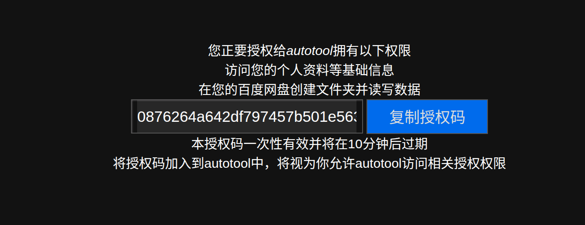
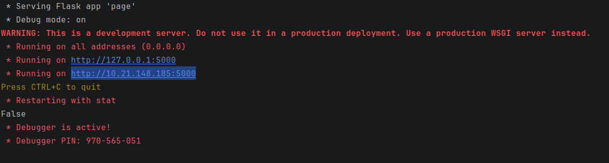
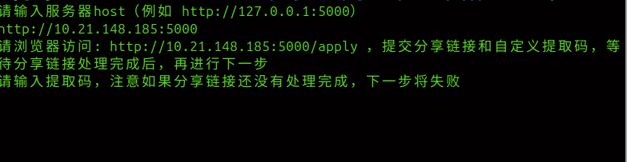
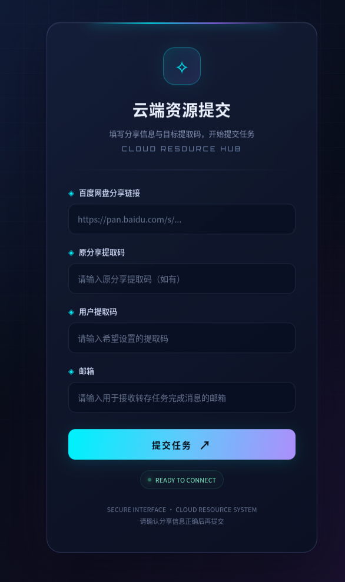

# 使用流程
## 服务端
### 环境搭建
```bash
pip install -r requirements.txt
```

### 开始配置
1. 进行百度网盘个人开发者认证（请自行完成）
2. 进入[API手册](https://pan.baidu.com/union/doc/%E4%BD%BF%E7%94%A8%E5%85%A5%E9%97%A8/%E4%BD%BF%E7%94%A8%E6%A6%82%E8%BF%B0/) 阅读相关api使用手册
3. 在控制台[控制台](https://pan.baidu.com/union/console/applist)中创建应用，并且完成应用认证
4. 在应用中点击编辑，获取`AppKey`，`SecretKey`，`AppID`
5. 在`src/token`中创建
```bash
──token
   ├── access_token.txt
   ├── appid.txt
   ├── appkey.txt
   ├── authorization_code.txt
   ├── cookie.txt
   ├── refresh_token.txt
   ├── email_password.txt
   └── secretkey.txt
```

6. 将`AppKey`，`SecretKey`，`AppID`保存到 `src/token/appkey.txt`, `src/token/appid.txt`, `src/token/secretkey.txt`
7. 浏览器访问下面的链接，注意填写`AppKey`，`AppID`，然后复制授权码，保存在`src/token/authorization_code.txt`
```bash
https://openapi.baidu.com/oauth/2.0/authorize?response_type=code&client_id=您应用的AppKey&redirect_uri=oob&scope=basic,netdisk&device_id=您应用的AppID
```

8. 运行`utils/get_access_token.py`
```bash
cd src/utils
python3 get_access_token.py
```
9. 在email_password.txt中写入以下内容
```yaml
smtp_server : （你的email服务器地址，比如 smtp.163.com）
smtp_port : （端口号，比如465）
sender : （你的email账号，比如xxx@163.com）
password : （你的email授权码）
```
10. 运行`api/page.py`
```bash
cd src/api
python3 page.py
```

11. 复制，得到的就是host（主机域）

---


## 客户端

### linux

1. 下载`cpp/linux`中的所有内容到本地，除了`main.cpp`
2. 运行`main`
```
cd cpp/linux
./main
```

3. 按照软件指示操作

### windows

1. 下载`cpp/windows`中的所有内容到本地，除了`main.cpp`
2. 运行`main.exe`
3. 按照软件指示操作


打开本地的cpp/linux/文件夹，运行main或main.exe

输入host

按照提示访问host页面，提交分享链接和自定义提取码

输入提取码，自动完成下载，下载的文件按照网盘中的文件目录结构保存